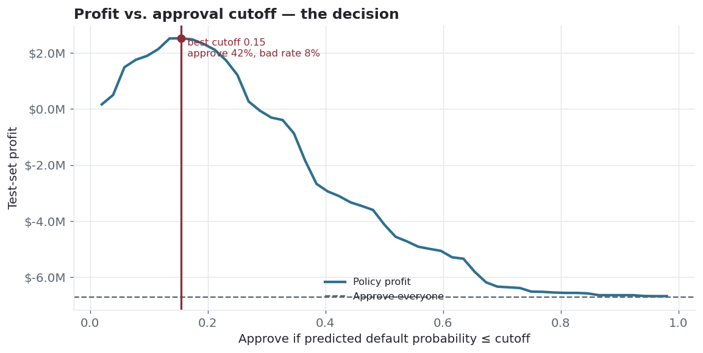
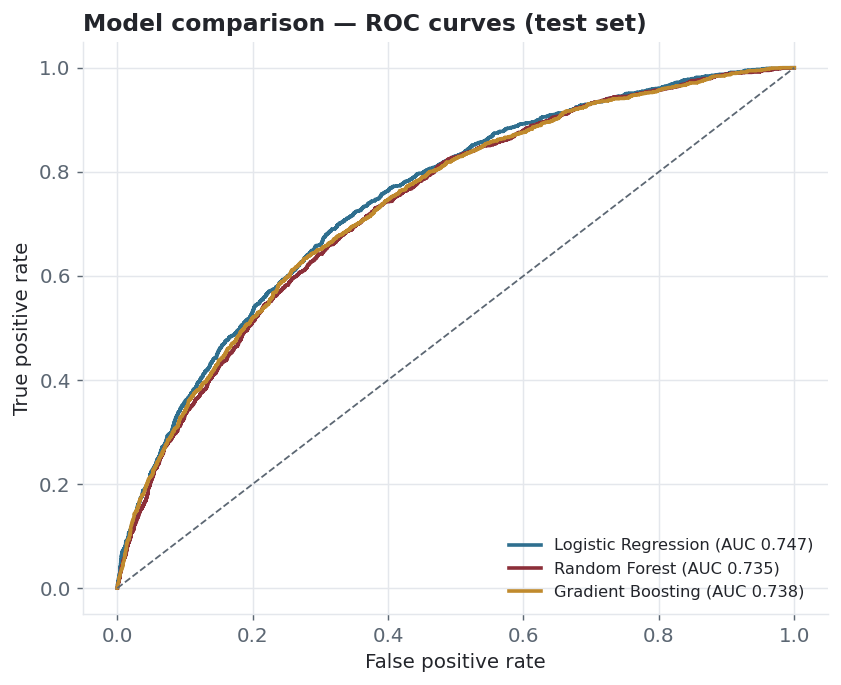
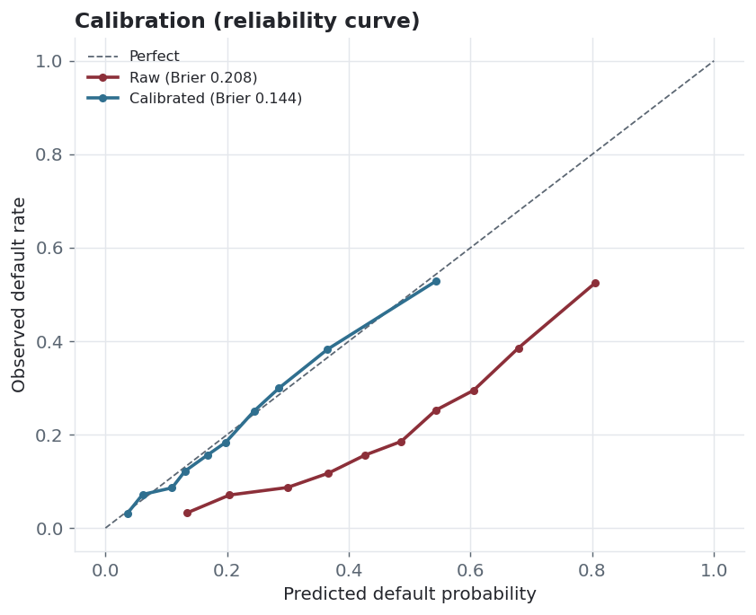
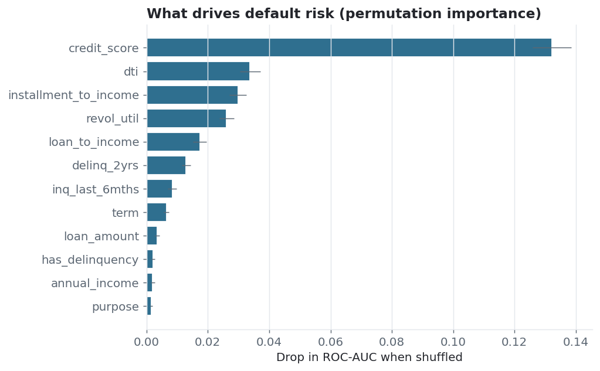

# DefaultRadar — credit-risk model & lending decision

Predicts loan default, but doesn't stop at a probability: it calibrates the
scores and turns them into an **approval cutoff that maximizes profit**, then
explains what drives the risk. Cleaning, feature engineering, model comparison,
calibration, a cost-based decision, and a leakage audit — end to end.




## The business question

A lender approving loans on gut feel either eats defaults or turns away good
borrowers. Given 30,000 loans, which applicants should we approve to make the
most money — not just which are "likely" to default?

## Results

**Model comparison (held-out test set):**

| Model | ROC-AUC | PR-AUC | KS | Brier |
|---|---|---|---|---|
| **Logistic Regression** | **0.747** | 0.443 | 0.373 | 0.208 |
| Gradient Boosting | 0.738 | 0.426 | 0.357 | 0.207 |
| Random Forest | 0.735 | 0.416 | 0.350 | 0.183 |

Logistic regression wins — narrowly, but it's also the most interpretable and the
easiest to defend to a regulator, so it's the pick. (Boosted trees are a one-line
swap; XGBoost too, if you have `libomp`.)

**Calibration matters here.** Balanced class weights push the raw probabilities
too high, so I calibrate (isotonic): **Brier 0.208 → 0.144**, and the reliability
curve snaps onto the diagonal. That's essential because the decision threshold
depends on the probabilities being honest.

**The decision.** With a 12% net margin on repaid loans and a 70% loss-given-
default, break-even is a ~15% default probability. Approving every applicant loses
**$6.7M** on the test book; approving only those below the model's profit-max
cutoff (0.15) turns that into a **$2.5M profit** — a **$9.2M swing** — while
cutting the approved book's default rate from **21% to 8%** (approving 42%).

**Top risk drivers** (permutation importance): credit score, DTI, installment-to-
income, revolving utilization, loan-to-income.

## Charts

| Model ROC comparison | Calibration (raw vs. calibrated) |
|---|---|
|  |  |

| Risk drivers | |
|---|---|
|  | |

## How it's built

- **Leakage audit first.** Columns known only *after* a loan runs (`recoveries`,
  `total_rec_prncp`, `last_pymnt_amnt`) are dropped before training — they'd give
  a fantastic score that collapses in production. [preprocess.py](src/preprocess.py)
- **Feature engineering.** Loan-to-income, installment-to-income, utilization and
  delinquency flags on top of the raw fields.
- **Honest comparison.** 5-fold stratified CV, then a held-out test set; the
  gradient-boosting model is tuned with a randomized search.
- **Cost-sensitive decision.** [decision.py](src/decision.py) sweeps the cutoff
  and picks the one that maximizes real expected profit — not a generic 0.5.
- **Explainability → policy.** Permutation importance drives the underwriting
  recommendations in [reports/model_card.md](reports/model_card.md).

## Quickstart

```bash
python3 -m venv .venv && source .venv/bin/activate
pip install -r requirements.txt

python src/run_all.py        # data → compare → calibrate → decide → charts + model
python tests/test_pipeline.py
```

## Repo structure

```
defaultradar/
├─ src/
│  ├─ generate_data.py   synthetic LendingClub-style loans (+ leakage cols)
│  ├─ preprocess.py      leakage audit, feature engineering, split
│  ├─ features.py        impute + scale + one-hot (ColumnTransformer)
│  ├─ train.py           model zoo, CV comparison, tuning
│  ├─ evaluate.py        ROC-AUC, PR-AUC, KS, Brier, calibration
│  ├─ decision.py        cost-based profit-max cutoff
│  ├─ explain.py         permutation importance
│  ├─ viz.py             charts
│  └─ run_all.py         end-to-end
├─ reports/              metrics + model card / policy memo
├─ powerbi/              risk-dashboard build guide
├─ models/               saved calibrated model
├─ tests/                pipeline tests
└─ assets/               charts
```

## Data

Ships with a generator that builds LendingClub-shaped loans so it runs with no
download; default risk is driven by credit score, rate, DTI, utilization and
delinquencies plus noise, so the achievable AUC (~0.74) is in the realistic range
rather than suspiciously perfect. To use the real thing, drop the LendingClub
`accepted` CSV in `data/`, keep the origination-time columns, and point
`preprocess.py` at it.

## Notes

- Business assumptions (12% margin, 70% LGD) are explicit in `decision.py` — change
  them and the cutoff moves; that's the point.
- Not a deployed scoring service; it trains, evaluates, and writes a scored file
  plus a saved model.
